# Zaka: every rand, with a plan

Zaka is a cash-first money planner for South Africans whose income is uneven: SASSA grants, piece jobs, selling and stokvels rather than one salary on the 25th. You tell it what came in and what went out (tap the keypad or just type "got R350 from a piece job"), and it answers the question that matters on a tight budget: **how much can I safely spend until my next money arrives, and which day will be tight?** It also checks suspicious SMS and WhatsApp messages for scam signs, and checks a loan quote against the legal maximums in the National Credit Regulations. All the maths runs in plain code on the phone and every number can be explained; AI is only used to read a typed sentence and to explain scam warning signs in the user's language. Zaka is JustIT Solutions' entry for the FNB App of the Year Hackathon 2026.

## Try it

- **Live app:** https://zaka.pages.dev (installable PWA; open it on a phone and "Add to Home screen")
- **Demo:** tap **Try the demo (Lerato)** on the sign-in screen, or sign in with `demo@zaka.app` / `Zaka2026!demo`
- **Demo video (67 s):** [docs/demo/zaka-demo.mp4](docs/demo/zaka-demo.mp4). Lerato picks isiXhosa, types a piece job, and checks a scam message and a loan. Every phone frame is recorded from the real app.
- Lerato is a synthetic person: 10 weeks of made-up grant, piece-job and spending history that is reloaded, ending today, each time "Try the demo" is tapped. The demo keeps the language you picked.

## Screenshots

Captured from a production build at 390×844 with the real demo account and live AI (`npm run screenshots`).

| Language picker | Home | Type it | AI fills the form |
| --- | --- | --- | --- |
| 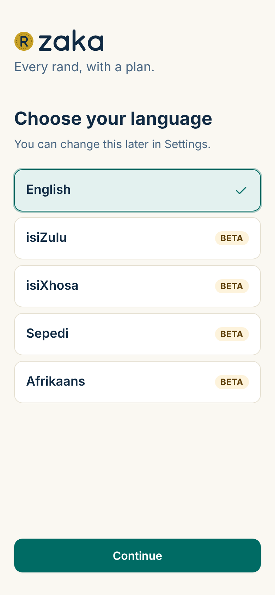 | 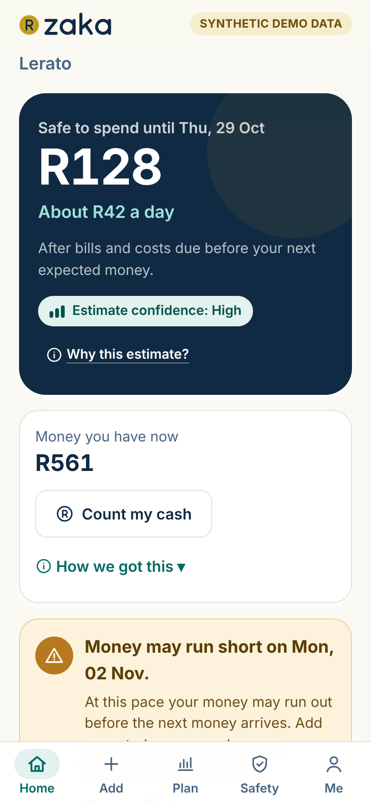 | 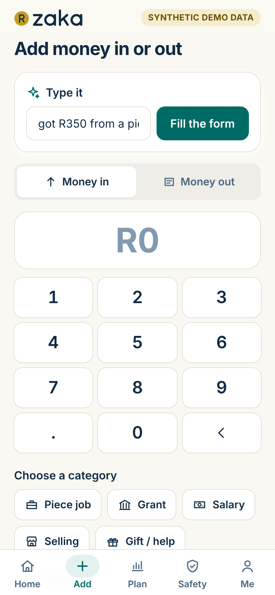 | 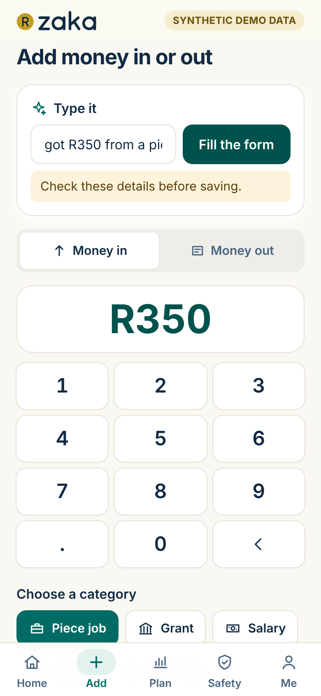 |
| **Saved: the tight day moves** | **Plan (14 days)** | **Why this estimate?** | **Scam Shield** |
| 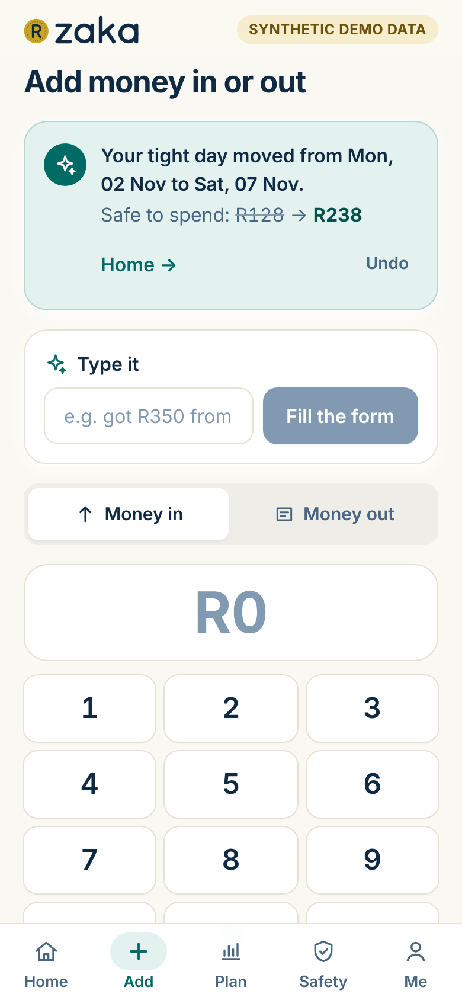 | 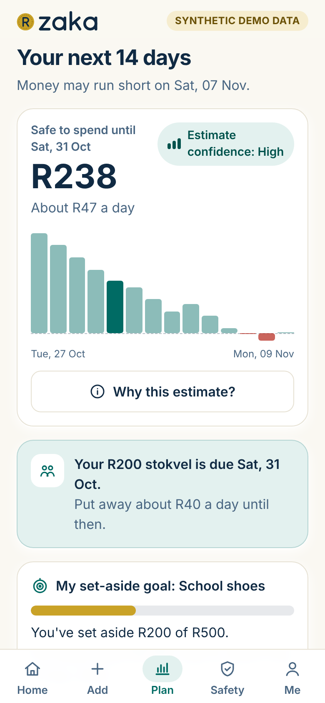 | 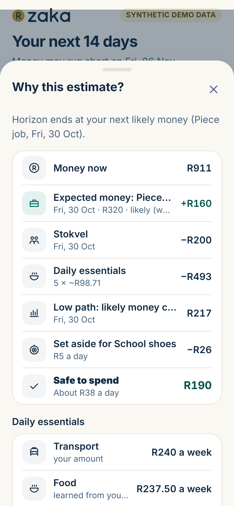 | 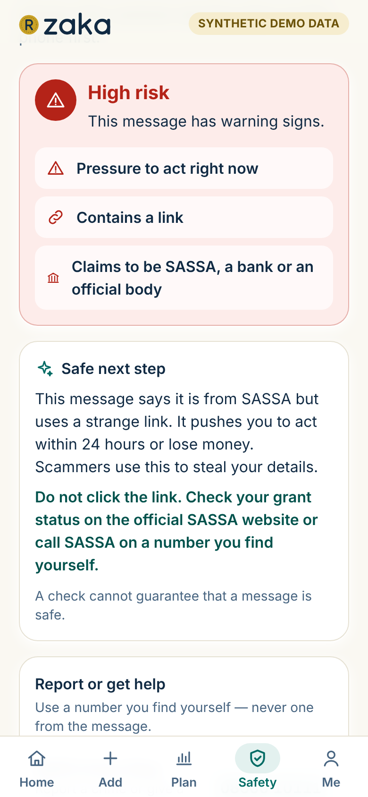 |
| **Scam Shield in isiXhosa** | **Loan Check** | **Me / language** | |
| 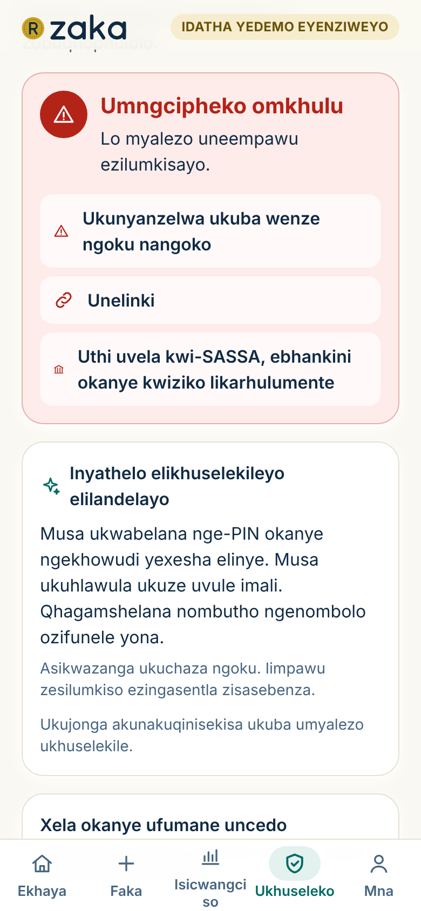 | 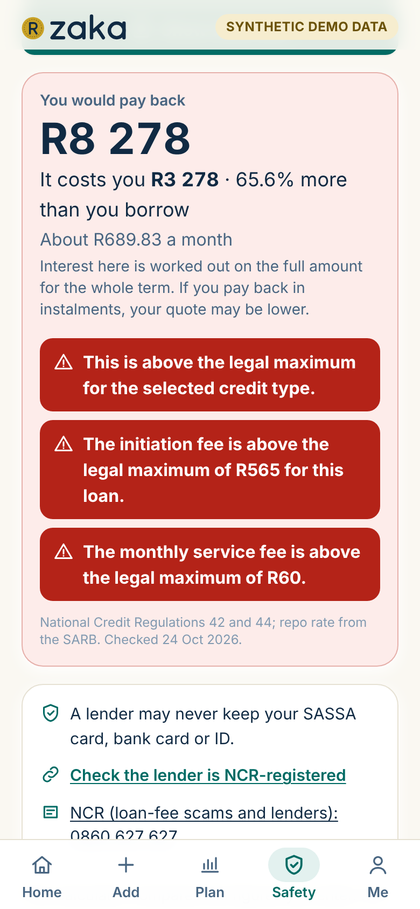 | 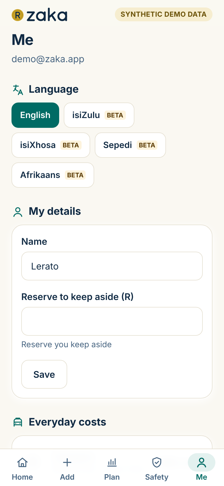 | |

## Features

- **Safe to spend until {date}**, plus a daily amount, from a 14-day plan that only counts money you can rely on.
- **Money you have now**, with a tap-to-open "How we got this" breakdown whose lines add up to safe to spend, and **Count my cash**: enter what you really have and Zaka records a visible "Balance correction".
- **Tight-day warning**: the first day the money is expected to run out, and what would cover the gap.
- **Type it**: write an entry in your own words in any of the five languages; AI fills the form and you check it before saving. If AI is unavailable, an on-phone parser fills what it can.
- **Learns patterns** from confirmed history: grant day, recurring weekly money, piece jobs per week, tightest day of the month, biggest spending weekday. Each pattern can be accepted or rejected.
- **Why this estimate?**: every line of the sum, with an honest confidence level (low, medium or high).
- **Bills, stokvels and goals**: amounts are set aside before anything is called safe to spend.
- **Scam Shield**: rules in code flag PIN/OTP requests, upfront fees, urgency, links, impersonation and more; AI then explains the risk and a safe next step in your language. The message itself is never stored, only which warning signs were found. Tap-to-call reporting numbers (SAPS Crime Stop, SASSA, NCR, banking ombud, six banks), each checked on official websites.
- **Loan Check**: totals what a loan really costs in rands and compares the interest rate, initiation fee and monthly service fee with the legal maximums for eight credit types (National Credit Regulations 42 and 44, repo rate 7.25% from 25 Sep 2026). It is not legal advice.
- **Works offline**: the last plan is cached on the phone and new entries queue in IndexedDB until there is a connection.
- **Five languages**: English, isiZulu, isiXhosa, Sepedi and Afrikaans (see below).
- **Your data, your call**: delete everything from the Me screen; read the plain-language [Privacy & Terms](https://zaka.pages.dev/privacy) (POPIA).
- **Optional 4-digit PIN lock** for shared family phones (see Authentication).
- **Feedback and sharing**: rate Zaka in the app and share it on WhatsApp with a proper link preview.

## Architecture

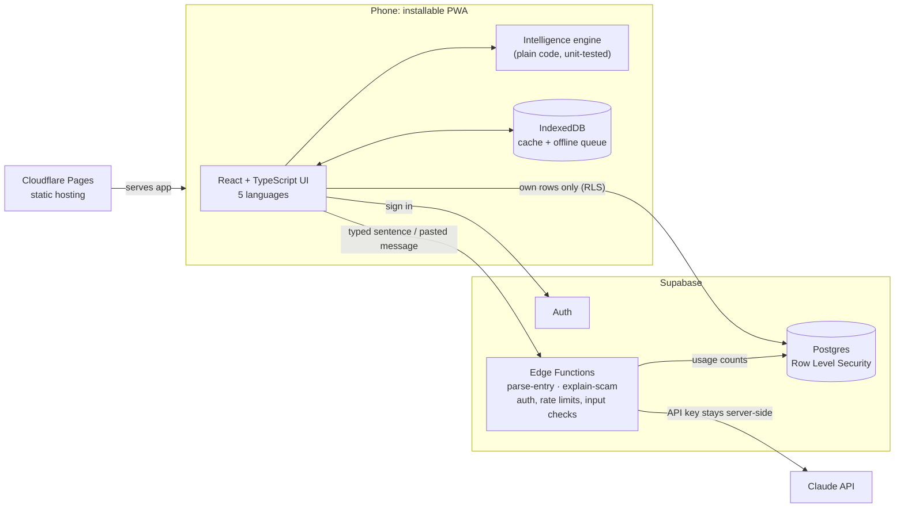

The browser holds only the public Supabase key; every table is protected by Row Level Security. The Claude API key exists only as a Supabase secret, so the phone never talks to Claude directly.

## The intelligence engine, simply

Zaka's forecast is deterministic code in `src/engine/`, not AI. It walks forward day by day on a **low path**: the cautious version of the next two weeks.

1. **Start with the money you have now.**
2. **Subtract what is coming out**: bills and stokvel contributions on their due days, and daily essentials (transport, food, electricity, data), using your own amounts or what it learned from your last four weeks.
3. **Add expected money, weighted by how sure it is**: confirmed counts in full, *likely* counts half, *possible* counts nothing.
4. **Stop at your next reliable money** (for example grant day or payday), or after 14 days if none is due.
5. **What is left, after your reserve and set-asides, is safe to spend**, shared across the days until that money arrives. The first day the running balance would go below zero is the **tight day**.

**Worked example** (an actual unit test in `src/engine/forecast.test.ts`): you have **R1,200**. Electricity of **R300** is due tomorrow. Essentials cost about **R100 a day**. A salary is expected in **5 days**, so Zaka plans 5 days, not 14. A piece job of about **R400** usually comes every few days, but it is only *likely*, so Zaka counts half: **R200**.

> R1,200 − R300 − (5 × R100) + R200 = **R600 safe to spend**, which is **R120 a day** until payday.

The salary itself is not counted: it is where the plan ends. A second test checks the opposite case: with R350, R300 due tomorrow and R100 a day of essentials, Zaka flags tomorrow as the tight day and shows R0 safe to spend.

Patterns (grant day, piece-job frequency and so on) come from confirmed history only and are shown with how often they were seen. Confidence is high only with enough history and a pattern seen three or more times.

## Real data, processed live (not a static site)

Every account, entry, bill and goal is stored in Postgres (Supabase) behind Row Level Security and synced in real time; sign-in uses Supabase Auth; "Type it" and Scam Shield call Edge Functions that use the Claude API. The forecast runs on the phone from the user's own data. The only made-up data is the clearly labelled synthetic demo (Lerato), reloaded on each "Try the demo".

## Authentication

- **Generic errors**: any failed sign-in says "Email or password is incorrect", so nobody can find out which emails have accounts; sign-up shows the same message for a new and an existing email.
- **Cool-down**: after 5 failed sign-ins the form waits 30 seconds (doubling up to 8 minutes), and a page refresh doesn't reset it. Supabase's own server-side rate limits stay on.
- **Strong passwords**: at least 8 characters with a letter and a number, shown as a live checklist.
- **Email** is trimmed, lower-cased and format-checked (no spaces, ≤254 characters). Password reset is not offered by email; the sign-in screen points to support@jis-tech.co.za.
- **Log out wipes the phone**: the session is revoked on the server, then every cached account, unsynced queue, session flag and the auth token are deleted (also when a session expires), so the next person on a shared phone sees nothing. Typing a protected address by hand shows the sign-in screen.
- **Optional PIN lock** (Me → Security): asked when the app opens and after 5 minutes away. Only a salted PBKDF2-SHA256 hash (210,000 iterations, WebCrypto) is stored, on the phone only; the PIN is never stored or sent. Easy PINs (1234, 0000, 1212…) are refused; 5 wrong tries → 30 s wait, 10 → sign out and wipe. "Forgot your PIN?" signs out, and the password resets it.

## Security & input validation

Every rule holds **on the phone, in the Edge Functions and in the database**, so calling the API directly with the public key gains nothing.

| Input | Rule (phone, server and database) |
| --- | --- |
| Amounts | Digits only, ≤2 decimals, more than R0 and at most R1,000,000; "R350", "350,50" and "1 250" accepted; letters, signs, "1e9", emoji refused. Above R50,000 (or a balance above R500,000) asks "is that right?" |
| Names and notes | Trimmed; control, zero-width and right-to-left override characters removed or refused; at least one letter; names ≤40, notes ≤140 characters. Output is always escaped by React (no `dangerouslySetInnerHTML` anywhere) |
| Dates | From 1 Jan 2024 to 7 days ahead; bills on day 1–31 (31 falls back to the last day of shorter months) |
| Type it | 3–200 characters; keyboard-mash and sentences without an amount are refused before any AI call; the AI may answer "unclear", and its amount must be a number the person actually wrote |
| Scam Shield | 10–2,000 characters with real words (not emoji or symbols only); the server re-runs the warning-sign rules itself, so a client can't tell the AI a scam is "low risk"; the message is never stored |
| Loan Check | Amount R100–R1,000,000, 0–100% a month or 0–1,000% a year, 1–360 months, fees ≥ R0; never shows NaN or Infinity |
| Everyday costs | Realistic ranges, e.g. daily transport R0–R1,000, food R0–R10,000 a week |
| Spam | At most 30 new rows a minute per user per table (a fresh demo is usable at once); demo caps stay |

- **Row Level Security on every table**: users can read and change only their own rows; reference prices are read-only; rate-limit counters can't be read through the API.
- **Prompt injection**: pasted messages are fenced as untrusted data, outputs are schema-checked, and claims such as "this message is safe" are blocked.
- **Edge Functions** need a signed-in user, check the origin, validate input and apply per-user limits (parse: 30 an hour / 200 a day; explain: 20 an hour / 100 a day) plus a project-wide daily AI budget. Logs contain no message text or personal data.
- **Demo lock-down**: the shared demo account's email and password can't be changed and it can't be deleted; its data is capped (60 entries, 15 bills, 15 goals, 100 scam checks); only it may be reset, at most every 15 seconds; clients can't fake "seed" rows to slip past the cap. Sign-ups are throttled to 60 an hour.
- **Web headers**: strict Content-Security-Policy, HSTS, no framing, no sniffing.
- **Shared demo AI allowance**: on the demo account each network (a hashed, daily-salted IP; nothing reversible is stored) gets a small share of the AI calls, plus a cap for the whole account, so one person can't use up every judge's allowance.
- **Secrets** (`ANTHROPIC_API_KEY`) live only in Supabase, never in this repository.

## Test results

| Check | Result | How |
| --- | --- | --- |
| Unit tests (forecast, balance breakdown, validators, auth rules, PIN, loan, dates…) | 134/134 | `npm test` |
| Attacks through the API with the public key (bad amounts, text, dates, enums, other users' IDs, fake seed rows, spam, demo abuse, feedback, car km/litres, Edge Function input) | 113/113 | `npm run test:attack` |
| Row Level Security and API abuse | 31/31 | `npm run test:rls` |
| Prompt injection | 15/15 | `npm run test:injection` |
| Demo account protections | 11/11 | `npm run test:demo` |
| Shared demo AI allowance (one person can't use up everyone's) | 2/2 | `npm run test:demo-ai` |
| Strict-judge browser pass (demo in 3 languages, entries, Type it, Plan, Scam Shield ×3, Loan Check, refresh, new account, log out wipe) | 17/17 | `npm run test:qa` |
| AI in all 5 languages | 13/13 | `npm run test:ai` |
| Translation key and placeholder parity | OK | `npm run check:i18n` |
| Small-phone layout, 320 px | 9 screens × 5 languages, no overflow | Playwright |
| Lighthouse 11, local production build (24 Oct) | PWA 100 · Accessibility 100 · Best Practices 100 · SEO 100 · Performance 94 | Lighthouse |

The live checks were run on 26 Oct 2026 with QA accounts (`*@zaka-qa.test`) that are deleted afterwards; re-running them needs those accounts to be created first.

## Languages

| Language | Status |
| --- | --- |
| English | Source |
| isiZulu | Beta: machine draft, native review pending |
| isiXhosa | Beta: machine draft, native review pending |
| Sepedi | Beta: machine draft, native review pending |
| Afrikaans | Beta: machine draft, native review pending |

Core strings (the D4 set) were provided by the team; the remaining UI strings were machine-drafted with key and placeholder checks, and every non-English language stays labelled **beta** until a native speaker signs it off. Dates use the device's language data, falling back to bundled CLDR names for isiZulu, isiXhosa and Sepedi when the browser has none.

## Run it locally

```bash
npm install
npm run dev          # http://localhost:5173, uses the hosted Supabase project and its public key
npm test             # engine unit tests
npm run build        # static dist/ for Cloudflare Pages (SPA fallback in public/_redirects)
npx vite preview     # serve the build on http://localhost:4173
```

To use another Supabase project, set `VITE_SUPABASE_URL` and `VITE_SUPABASE_PUBLISHABLE_KEY`, apply `supabase/migrations`, deploy `supabase/functions` (run `npm run sync:functions` first) and set the `ANTHROPIC_API_KEY` secret. Local origins `localhost:5173` and `localhost:4173` are allowed by the Edge Functions.

## Repository layout

- `src/engine/`: pure, unit-tested intelligence (patterns, forecast, insights, scam rules, loan maths, legal limits)
- `src/screens/`, `src/components/`: the UI
- `src/lib/store.tsx`: Supabase sync, IndexedDB cache and offline queue
- `src/i18n/`: language files
- `supabase/migrations/`, `supabase/functions/`: database schema, RLS, guards and Edge Functions
- `tests/`: live security and AI tests
- `scripts/`: demo seed, translation, screenshot and i18n tools

All demo data is synthetic. Zaka never moves money and does not decide whether anyone qualifies for credit.
